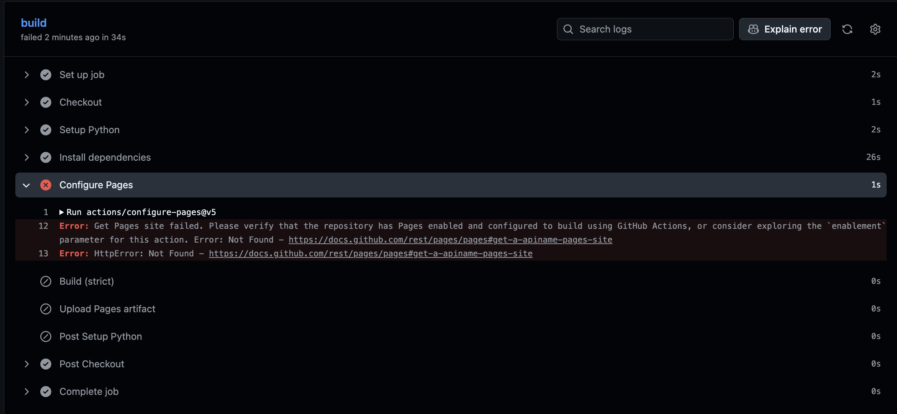
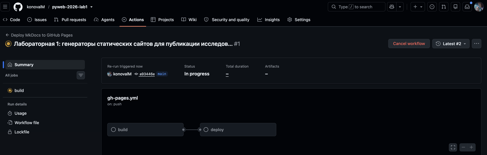
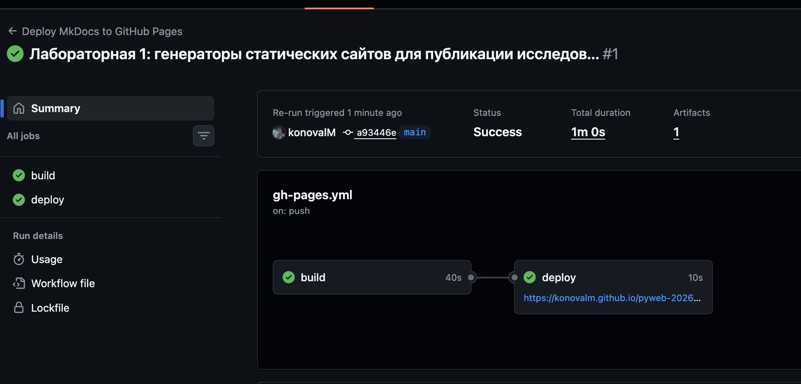

# Отчёт по лабораторной работе №1

**Курс:** Проектирование и развертывание веб-решений в эко-системе Python
**Тема:** Генераторы статических сайтов (SSG) для публикации результатов исследований
**Выбрано:** исследовательское задание **T1** (сравнительный анализ генераторов) и
практическое задание **P2** (страница — стресс-тест научного контента)
**Предметная область:** предиктивная диагностика промышленного оборудования
(Predictive Sensorics) — прогноз остаточного ресурса по вибродиагностике.

---

## 1. Цель и постановка

Исследовать генераторы статических сайтов на Python как инструмент публикации
результатов вычислительных экспериментов и собрать собственный сайт, публикуемый
средствами CI/CD на GitHub Pages и отечественном хостинге (сервер Selectel).

В качестве демонстрационного контента взята методика оценки остаточного ресурса
(RUL) подшипника по тренду виброускорения: формулы, таблицы, статический и
интерактивный графики, список литературы.

## 2. Ход работы

| № | Шаг | Что сделано |
|---|-----|-------------|
| 1 | Python + pip + virtualenv | Python 3.12.3 (pyenv); venv в `.venv` |
| 2 | Каталог проекта, venv, активация | `python -m venv .venv` |
| 3 | Зависимости и gitignore | зафиксированы версии в requirements.txt; из игнора — .venv/, site/, \_build/, docs/assets/generated/ |
| 4 | Каркас MkDocs + Material | `mkdocs.yml`, тема Material, RU-поиск |
| 5 | `mkdocs serve` / `mkdocs build --strict` | строгая сборка проходит без предупреждений |
| 6 | Git + GitHub | репозиторий, ветка `main` |
| 7 | GitHub Actions → Pages | `gh-pages.yml` (official `upload-pages-artifact` + `deploy-pages`) |
| 8 | Базовый URL | `site_url` через `SITE_URL` (env), `use_directory_urls: true` |
| 9 | Отечественный хостинг | развёрнут на сервере Selectel (`scripts/deploy-selectel.sh`): изолированный контейнер nginx на :80, rsync по SSH, healthcheck. Шаблон CI — `deploy-selectel.yml` |
| 10 | Лицензии | контент — CC BY 4.0 (`LICENSE-content`), код — MIT (`LICENSE`) |

: Ход работы по шагам задания {tbl-colwidths="[6,30,64]"}

**Различие двух подходов к публикации на Pages (п.8 задания).**
Исторический путь — `peaceiris/actions-gh-pages`: сборка пушится в ветку
`gh-pages`, которую Pages раздаёт как «classic» источник. Официальный путь
(использован в работе) — артефакт сборки загружается через
`actions/upload-pages-artifact` и публикуется `actions/deploy-pages` с источником
**GitHub Actions**: не засоряется история, права выдаются через OIDC
(`id-token: write`), не нужен personal access token.

## 3. Задание T1 — сравнительный анализ генераторов

Рассмотрены четыре генератора: **MkDocs + Material**, **Sphinx + MyST-Parser**,
**Pelican**, **Quarto**. Оценки по шкале 1–5; вес критерия отражает важность для
публикации **научного** контента (формулы, графики, цитирование — приоритетны).

### 3.1. Матрица «критерий × генератор»

| Критерий | Вес, % | MkDocs+Material | Sphinx+MyST | Pelican | Quarto |
|----------|:---:|:---:|:---:|:---:|:---:|
| Формулы LaTeX: нумерация + `\eqref` | 9 | 4 | 5 | 3 | 5 |
| Форматы исходников (md/rst/ipynb/qmd) | 7 | 2 | 4 | 3 | 5 |
| Сложные таблицы (merged cells) | 5 | 4 | 4 | 3 | 4 |
| Интерактивные графики (Plotly/Bokeh) | 9 | 3 | 3 | 2 | 5 |
| Подсветка кода | 5 | 5 | 5 | 4 | 5 |
| Автосписок литературы из `.bib` | 7 | 4 | 5 | 3 | 5 |
| Экспорт в PDF/печать | 7 | 2 | 5 | 2 | 5 |
| Готовые темы (качество из коробки) | 7 | 5 | 4 | 4 | 4 |
| Кастомизация вёрстки | 6 | 4 | 4 | 4 | 3 |
| Документация проекта | 5 | 5 | 5 | 3 | 4 |
| Локализация RU (интерфейс/поиск) | 5 | 5 | 4 | 3 | 3 |
| Экосистема плагинов/расширяемость | 6 | 4 | 5 | 3 | 3 |
| Автодокументирование кода (API docs) | 6 | 3 | 5 | 1 | 3 |
| Зрелость и сообщество | 5 | 4 | 5 | 3 | 4 |
| Простота CI + GitHub Pages | 6 | 5 | 4 | 4 | 4 |
| Версионирование (`mike` и аналоги) | 5 | 5 | 3 | 2 | 3 |
| **Итоговый взвешенный балл (0–100)** | **100** | **78.0** | **87.2** | **58.2** | **83.2** |

### 3.2. Обоснование весов

- **Научный контент — доминирующая группа (~55% суммарного веса).** Формулы с
  нумерацией, интерактивные и статические графики, цитирование из `.bib` и
  экспорт в PDF — это ядро задачи «публикация результатов исследований», поэтому
  им отданы веса 7–9.
- **Эксплуатация (~27%):** документация, RU-локализация, расширяемость, зрелость —
  важны для долгоживущего проекта, но вторичны относительно контента (веса 5–6).
- **Вёрстка и CI (~18%):** качество тем и простота деплоя влияют на скорость
  старта, но слабо дифференцируют генераторы между собой (веса 5–7).

### 3.3. Выводы по T1

- **Sphinx + MyST (87.2)** — лидер за счёт сильнейшей экосистемы (autodoc,
  `sphinxcontrib-bibtex`), нативного экспорта в PDF (`latexpdf`) и зрелости.
- **Quarto (83.2)** — лучший именно по «научности»: нативно исполняет код,
  встраивает Plotly, тянет `.ipynb`/`.qmd`, умеет PDF и кросс-ссылки из коробки.
  Минус — отдельный тяжёлый toolchain (не ставится через `pip`).
- **MkDocs + Material (78.0)** — лучшая тема «из коробки», простейший CI и
  версионирование (`mike`), но слабее в PDF и форматах исходников.
- **Pelican (58.2)** — универсальный, но под научный контент требует ручной
  доводки (формулы, библиография, интерактив) — отстаёт.

## 4. Задание P2 — страница «стресс-тест» научного контента

Одна и та же страница «Прогноз остаточного ресурса по вибродиагностике» собрана
**тремя** генераторами (MkDocs, Sphinx, Quarto). Все обязательные элементы
реализованы на каждом.

### 4.1. Реализация обязательных элементов

| Элемент | MkDocs + Material | Sphinx + MyST | Quarto |
|---------|-------------------|---------------|--------|
| Нумерованные формулы + ссылка из текста | `arithmatex` + MathJax `tags:'ams'`, `\eqref` | `$$…$$ (eq:rms)` + `{eq}` role | `$$…$$ {#eq-rms}` + `@eq-rms` |
| Таблица с объединёнными ячейками + подпись | сырой HTML-`<table>` + плагин `caption` | `{raw} html` + `<caption>` | `{=html}` + `<caption>` |
| Статический график (matplotlib) | `` + `caption` | `{figure}` + `:name:` | `{#fig-rms}` |
| Интерактивный график (Plotly) | `<iframe>` на html-фрагмент | `{raw} html` iframe | `{=html}` iframe |
| Листинг кода с подсветкой | `pymdownx.highlight` + linenums | `{code-block}` `:linenos:` | ```` ```python ```` |
| Автосписок литературы из `.bib` | `mkdocs-bibtex`, `[@key]` + `\bibliography` | `sphinxcontrib-bibtex`, `{cite}` + `{bibliography}` | нативно, `[@key]` + `::: {#refs}` |
| Двухколоночный блок | `<div class="two-col">` + CSS grid | `{raw} html` grid | `::: {.columns}` |
| Сноска | `footnotes` (`[^phm]`) | MyST `[^phm]` | `[^phm]` |
| Перекрёстная ссылка на раздел | `toc` permalink `#model` | `{ref}` на `(priznaki)=` | `@sec-priznaki` |

Источник библиографии — **единый** `docs/refs.bib` для всех трёх сборок (у Sphinx
и Quarto путь указывает на тот же файл), что исключает рассинхрон цитат.

### 4.2. Воспроизводимость (данные → график → сайт)

Графики не хранятся в git (каталог `docs/assets/generated/` в `.gitignore`), а
пересобираются из `data/degradation.csv` скриптом `scripts/gen_figures.py`.
Скрипт подключён как **MkDocs-хук** (`on_pre_build`), поэтому `mkdocs build`
гарантированно строит графики из актуальных данных: изменил CSV → пересобрал
сайт → графики обновились.

### 4.3. Измерения P2

Усреднение по 3 прогонам (прогретый кэш), macOS, Apple Silicon, Python 3.12.3.
Вес страницы — файл `rul-vibration(.html)`; gzip — та же страница под gzip.

| Генератор | Время сборки, с | Страница, КБ | Страница gzip, КБ | Весь сайт |
|-----------|:---:|:---:|:---:|:---:|
| MkDocs + Material | 1.17 | 48 | 11.2 | 2.7 МБ |
| Sphinx + MyST | 0.52 | 32 | 7.9 | 676 КБ |
| Quarto | 1.34 (тёплый) / ~5.0 (холодный) | 40 | 11.5 | 1.2 МБ |

**Интерпретация.** Sphinx даёт самую лёгкую и быструю сборку; «вес» MkDocs — это
тема Material (иконки, шрифты, JS поиска), что оправдано богатым UI. Quarto при
первом запуске прогревает связку Pandoc + Deno (отсюда холодные ~5 с), на
повторных сборках сопоставим с MkDocs.

## 5. Публикация (ссылки)

- Репозиторий GitHub: <https://github.com/konovalM/pyweb-2026-lab1>
- Сайт на GitHub Pages: <https://konovalm.github.io/pyweb-2026-lab1/>
- Сайт на отечественном хостинге (Selectel): <http://94.154.130.35.sslip.io/>

> Про «отечественность»: хостинг-провайдер — **Selectel** (российская компания,
> как Timeweb/VK Cloud/Cloud.ru из примеров задания); конкретная нода
> расположена за пределами РФ. Требование «отечественный хостинг» трактуется по
> провайдеру.

### 5.1. Развёртывание на Selectel (что сделано)

Сайт развёрнут **рядом** с уже работающими на сервере сервисами (Telegram-бот
`ai-system`, панель `3x-ui`, Portainer и др.) — в **изолированном контейнере**
`nginx:alpine` на свободном порту 80, без остановки или изменения существующих
контейнеров. Пайплайн оформлен скриптом `scripts/deploy-selectel.sh`:

1. `mkdocs build --strict` с `SITE_URL=http://94.154.130.35.sslip.io/`;
2. `rsync -az --delete` статики в `/opt/ps-research/html`;
3. `docker run` контейнера `ps-research` (порт 80, монтирование статики и
   nginx-конфига только на чтение, `--restart unless-stopped`);
4. healthcheck: HTTP-код + контрольная строка `PS-RESEARCH-LIVE`.

nginx отдаёт «красивые» URL каталогов через `try_files $uri $uri/
$uri/index.html =404` — без этого `use_directory_urls: true` вернул бы 404 на
страницах вида `/research/rul-vibration/` (на GitHub Pages это решается
автоматически, на своём nginx — вручную).

### 5.2. Измерения деплоя

| Этап | Значение |
|------|----------|
| Загрузка статики (rsync, 55 файлов) | < 1 с |
| Старт контейнера (без учёта однократного `docker pull`) | ~2 с |
| Healthcheck снаружи: код ответа | HTTP 200 |
| Healthcheck снаружи: время ответа главной | 0.49 с |
| Контрольная строка в HTML | найдена |

## 6. Отладка (реальные ошибки)

### Ошибка 1 — сборка падает на библиографии
- **Текст:** `AttributeError: 'Style' object has no attribute 'format_standard'`
  (трейс из `pybtex/style/formatting`).
- **Гипотеза:** `mkdocs-bibtex`/pybtex не знает тип BibTeX-записи `@standard`,
  который я использовал для ISO 10816.
- **Проверка:** в `docs/refs.bib` только одна запись типа `@standard`; стиль
  `plain` pybtex имеет методы `format_article/book/...`, но не `format_standard`.
- **Решение:** заменил тип записи на поддерживаемый `@manual` (поля `organization`,
  `address` сохранены). Сборка прошла.

### Ошибка 2 — предупреждение Plotly при генерации графика
- **Текст:** `UserWarning: Unrecognized config options supplied: ['displmodeBar']`.
- **Гипотеза:** опечатка в ключе конфигурации Plotly.
- **Проверка:** в документации параметр называется `displayModeBar`, а не
  `displmodeBar`; опечатка тихо игнорировалась, панель инструментов не включалась.
- **Решение:** исправил ключ на `displayModeBar` в `scripts/gen_figures.py`.

### Ошибка 3 — пустые значения времени в скрипте измерений
- **Текст:** вывод `build: s page: 48KB` — число перед `s` отсутствует.
- **Гипотеза:** вывод `/usr/bin/time -p` (stderr) проглатывается вместе с выводом
  самой команды.
- **Проверка:** в конструкции `/usr/bin/time -p mkdocs build … 2>/dev/null`
  редирект `2>/dev/null` гасит stderr и команды, и `time`, поэтому `awk` не
  находит строку `real`.
- **Решение:** обернул саму команду в `sh -c '… >/dev/null 2>&1'`, а `time`
  оставил писать в перехватываемый stderr: `{ /usr/bin/time -p sh -c '…'; } 2>&1`.

### Ошибка 4 — Quarto не ставится в неинтерактивной среде
- **Текст:** `sudo: a terminal is required to read the password … installer … exited with 1`
  при `brew install --cask quarto`.
- **Гипотеза:** cask Quarto ставится системным `installer` под `sudo`, а пароль
  ввести в автоматическом режиме нельзя.
- **Проверка:** pkg Quarto — это обычный архив payload'а, установка через `sudo`
  нужна лишь для записи в системные каталоги.
- **Решение:** скачал `.pkg`, распаковал без прав: `pkgutil --expand-full`,
  перенёс `Payload` в `~/.local/share/quarto`, добавил `bin/` в `PATH`. `quarto
  --version` → 1.11.9, рендер работает.

### Ошибка 5 — каталоги сборки попали в git-индекс
- **Текст:** `git status` показывает `site/`, `quarto/_site/` как добавленные,
  хотя они перечислены в `.gitignore`.
- **Гипотеза:** паттерны в `.gitignore` записаны с комментарием в той же строке
  (`site/          # MkDocs`).
- **Проверка:** git **не поддерживает** inline-комментарии в `.gitignore` — вся
  строка, включая `# MkDocs`, считается именем пути, который ничему не
  соответствует, поэтому `site/` не игнорируется.
- **Решение:** вынес комментарии на отдельные строки; удалил уже закэшированные
  каталоги `git rm -r --cached site quarto/_site` и пересобрал индекс.

## 7. Вывод

**Рекомендуемый стек для публикации результатов исследований в предиктивной
диагностике — MkDocs + Material** как основной сайт-витрина: лучшая тема и
RU-поиск из коробки, тривиальный CI на GitHub Pages, встроенное версионирование
(`mike`) для публикации версий методик (v1.0/v1.1/latest). Там, где нужен
**вычислительный** материал (исполняемые ноутбуки, автогенерация графиков, строгий
экспорт в PDF для отчётности) — дополнять **Quarto** для отдельных страниц, а для
документирования кодовой базы библиотек обработки сигналов — **Sphinx** с
`autodoc`.

**Ограничения, при которых рекомендация меняется:**
- Если ключевой артефакт — Jupyter-ноутбуки и воспроизводимые вычисления с PDF →
  основной генератор **Quarto**.
- Если публикуется API-документация Python-библиотеки → основной **Sphinx**
  (`autodoc` + `sphinxcontrib-bibtex`).
- Если требуется развёртывание исключительно на отечественном хостинге без
  GitHub — выбор генератора вторичен; критичнее перенос CI на GitVerse/SourceCraft
  или GitLab CI на сервере (как уже сделано для ps-landing).

## Приложение. Скриншоты запусков CI

**Проваленный запуск** — сборка падает на шаге *Configure Pages* (`Get Pages site
failed`), потому что в репозитории ещё не включён источник Pages = GitHub Actions
(см. также раздел «Отладка»):



**Запуск после включения Pages (в процессе):** граф `build → deploy`:



**Успешный запуск** — статус *Success*, общая длительность 1m 0s
(`build` 40 с → `deploy` 10 с), опубликован артефакт и URL GitHub Pages:



### Время публикации на GitHub Pages (из CI)

| Этап workflow | Время |
|---------------|-------|
| build (сборка `mkdocs build --strict` + графики) | 40 с |
| deploy (`deploy-pages`) | 10 с |
| **Итого прогон** | **1 мин 0 с** |

### Проверка отечественного хостинга (Selectel)

```console
$ curl -s -o /dev/null -w "%{http_code} %{time_total}s\n" http://94.154.130.35.sslip.io/
200 0.489s
$ curl -s http://94.154.130.35.sslip.io/ | grep -o "PS-RESEARCH-LIVE"
PS-RESEARCH-LIVE
```
