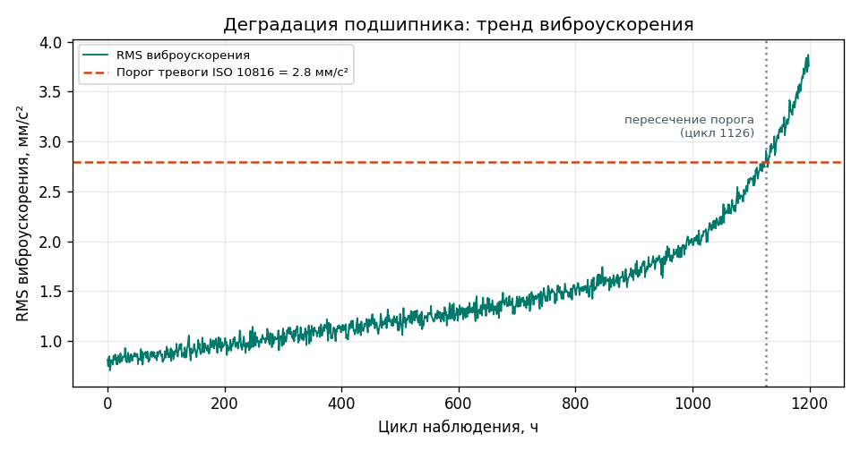

Страница собрана на **Quarto** и содержит тот же научный контент, что
MkDocs- и Sphinx-версии: нумерованные формулы, таблицу с объединёнными
ячейками, статический и интерактивный графики, подсветку кода и автосписок
литературы.

Задача прогностики (PHM[^phm]) — оценить остаточный ресурс узла по косвенным
признакам из сигнала виброускорения [@lei2018machinery].

[^phm]: PHM — Prognostics and Health Management, раздел технической диагностики.

## Признаки деградации {#sec-priznaki}

Базовый признак — среднеквадратичное значение (RMS) виброускорения на окне из
$N$ отсчётов $a_i$:

$$
\mathrm{RMS} = \sqrt{\frac{1}{N}\sum_{i=1}^{N} a_i^{\,2}}
$$ {#eq-rms}

Более ранний индикатор дефекта — эксцесс (kurtosis) [@randall2011rolling]:

$$
\mathrm{Kurt} = \frac{\frac{1}{N}\sum_{i=1}^{N}(a_i-\bar a)^4}
{\left(\frac{1}{N}\sum_{i=1}^{N}(a_i-\bar a)^2\right)^{2}}
$$ {#eq-kurt}

Признак @eq-kurt срабатывает раньше, чем порог по @eq-rms — это перекрёстные
ссылки на нумерованные уравнения.

{#fig-rms width=100%}

## Модель остаточного ресурса {#sec-model}

Надёжность узла описываем распределением Вейбулла [@weibull1951statistical]:

$$
R(t) = \exp\!\left[-\left(\frac{t}{\eta}\right)^{\beta}\right],
\qquad
\mathrm{RUL}(t_0) = \mathbb{E}[t - t_0 \mid t > t_0]
$$ {#eq-rul}

Оценка по @eq-rul выполняется в момент пересечения индексом здоровья порога.
Динамику показывает интерактивный график:

```{=html}
<iframe src="assets/rul_interactive.html"
        style="width:100%;min-height:440px;border:1px solid #ddd;border-radius:6px"
        title="Индекс здоровья и эксцесс (Plotly)" loading="lazy"></iframe>
```

### Пороговые зоны по ISO 10816

Таблица с объединёнными ячейками (`rowspan`/`colspan`) по [@iso10816]:

```{=html}
<table>
  <caption>Таблица 1. Зоны вибрации и регламент обслуживания (ISO 10816-3).</caption>
  <thead>
    <tr><th rowspan="2">Зона</th><th colspan="2">RMS виброскорости, мм/с</th>
        <th rowspan="2">Решение оператора</th></tr>
    <tr><th>от</th><th>до</th></tr>
  </thead>
  <tbody>
    <tr><td>A — новое</td><td>0.0</td><td>1.4</td>
        <td rowspan="2">Эксплуатация без ограничений</td></tr>
    <tr><td>B — допустимо</td><td>1.4</td><td>2.8</td></tr>
    <tr><td>C — контроль</td><td>2.8</td><td>4.5</td><td>Планировать обслуживание</td></tr>
    <tr><td>D — недопустимо</td><td>4.5</td><td>—</td><td>Останов, риск разрушения</td></tr>
  </tbody>
</table>
```

## Применимость и ограничения

::: {.columns}
::: {.column width="48%"}
**Где метод работает**

- Подшипники качения с выраженной ударной картиной дефекта.
- Наличие прогонов run-to-failure для калибровки порогов [@saxena2008cmapss].
- Стационарные режимы нагрузки.
:::
::: {.column width="48%"}
**Где метод ломается**

- Переменная частота вращения.
- Единичные узлы без обучающей выборки отказов.
- Сильные внешние вибропомехи.
:::
:::

## Воспроизводимый расчёт {#sec-raschet}

Код вычисляет признаки @eq-rms–@eq-kurt:

```python
import numpy as np
import pandas as pd

RMS_ALARM = 2.8  # порог тревоги, мм/с^2 (ISO 10816, зона C)


def features(window: np.ndarray) -> tuple[float, float]:
    rms = np.sqrt(np.mean(window ** 2))
    centered = window - window.mean()
    kurt = np.mean(centered ** 4) / (np.mean(centered ** 2) ** 2)
    return float(rms), float(kurt)
```

Переход к разделу @sec-priznaki — перекрёстная ссылка на другой раздел.

## Список литературы

::: {#refs}
:::
